<div align="center">

# OFFSCRIPT

**Every decision creates another game.**

Multi-agent counterfactual football intelligence · Microsoft × Premier League *Inside the Game* Hackathon 2026

**[Live demo](https://parallelwebplb33l5h5wpok.z1.web.core.windows.net)** · [Open the app](https://parallelwebplb33l5h5wpok.z1.web.core.windows.net/app/) · agents running live on Microsoft Foundry

<sub>The API scales to zero when idle: the first visit after a quiet period shows a "warming up" screen for 20-40 seconds.</sub>

</div>

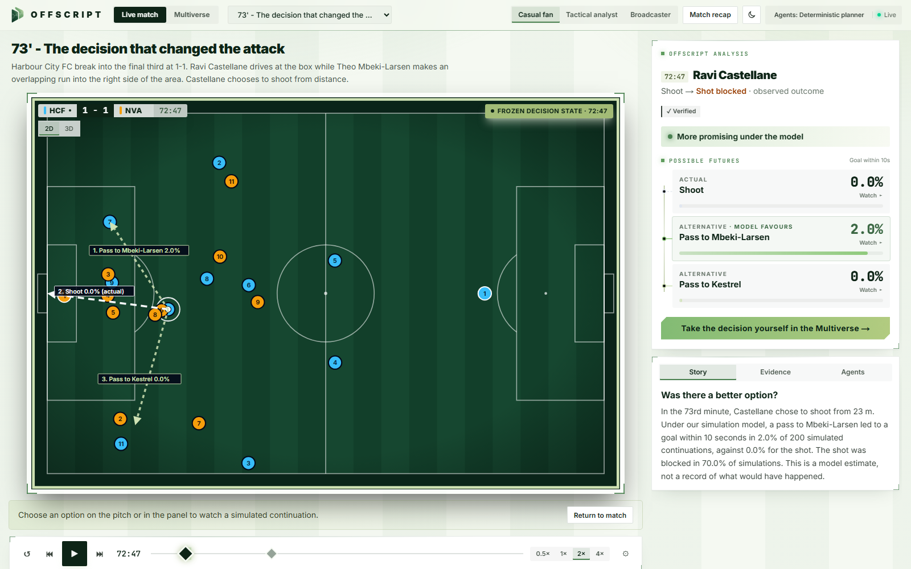

OFFSCRIPT watches a live (synthetic) football match, detects the decisions that matter, and asks the
question fans actually have: **was there a better option?** Five specialised agents built on
**Microsoft Agent Framework** propose feasible alternatives, run paired Monte Carlo simulations from
the exact frozen game state, verify every number and claim, and explain the trade-offs to fans,
analysts and broadcasters. You can then **watch the alternative play out** in 2D or 3D, always
labelled as one sampled continuation of a model, with its uncertainty, or **take the decision
yourself** in the Football Multiverse and let an attacking and a defending agent fight over it.

> OFFSCRIPT never claims to know what *would* have happened. Alternatives are estimates from an
> explicit, uncalibrated simulation model of a synthetic match. See [limitations](docs/limitations.md).

## What you can do

* **Watch a live synthetic match**: server-paced event stream over WebSocket, animated pitch,
  live event feed, statistics (observed vs modeled values kept apart).
* **Decisions are detected automatically** from the pre-decision snapshot (no future information);
  playback pauses at the frozen decision state with the options drawn on the pitch, labels placed so
  they never overlap.
* **Compare options on one metric**: P(goal within 10 s), plus shot and turnover risk, with Wilson
  95% intervals and paired comparisons; verdicts only when the evidence supports them.
* **Watch the alternative in 2D or 3D**: a representative simulated continuation (medoid of the
  modal outcome), scrub it, replay it, or view example rollouts per outcome. The 3D view has
  broadcast, tactical and player cameras.
* **Three genuinely different viewer modes**: Casual fan, Tactical analyst (intervals, evidence,
  assumptions, checks), Broadcaster (lower third, timing, priority, machine-readable overlay JSON).
* **See the agents work, live**: while an analysis runs, a live log shows which agent is working,
  every tool call and every handoff (a live Foundry run takes 30-60 s, so it never looks frozen).
  Afterwards the workflow inspector keeps every step, structured output and retry.
* **Stress test: break it on purpose**: sabotage a copy of the analysis (an impossible pass, a false
  number in the story, an AI model outage, a simulation cut short) and watch a three-step story of
  what was broken, how the agents caught it and what was published. The real result is never touched.
* **Decision Value Added (DVA)**: analyse every detected decision of a match and see, per player and
  per team, how much modeled goal chance was left on the table by not taking the model's best
  option, with 95% intervals. Players below the decision minimum are folded away, not ranked.
* **Match recap** (casual and analyst) grounded in event ids and verified analyses.
* **Football Multiverse**: take the decision yourself. Click a teammate, a space or a dribble target;
  an **attacking agent** and a **defending agent** plan against each other over a bounded response
  matrix (paired Monte Carlo per action × defence). While they plan you see each round's proposals
  and the matrix filling cell by cell. The chosen continuation becomes a new frozen state and you
  decide again. Rewind, fork sibling branches, let the agents recommend (assisted) or play it out
  (autonomous), and compare two branches side by side. Analyst mode leads with the key finding and
  keeps the full write-up one click away. → [docs/multiverse.md](docs/multiverse.md)

| Tactical analyst | What-if playback |
|---|---|
| 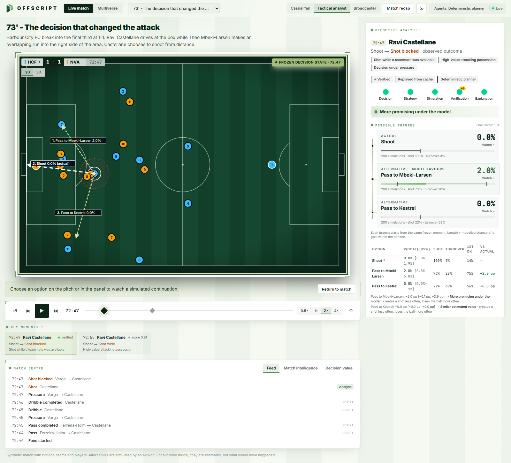 | 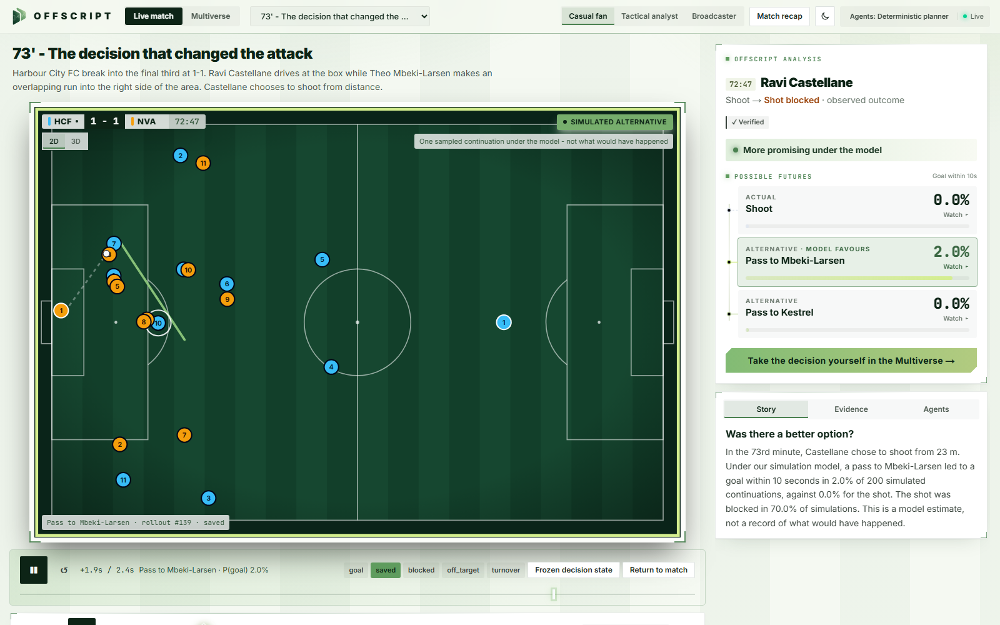 |
| **3D view** (broadcast camera, frozen decision) | **Stress test** (false number → caught → rewritten) |
| 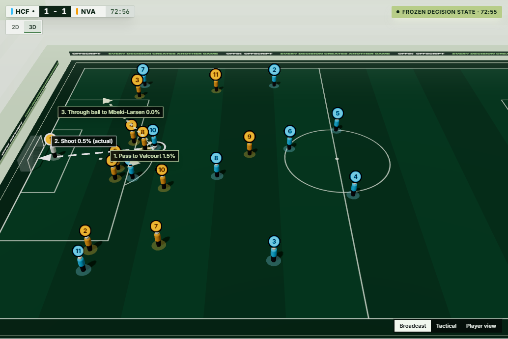 | 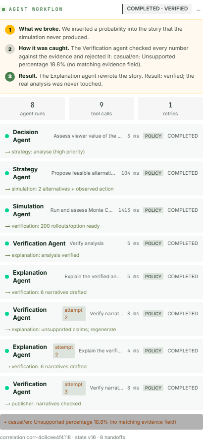 |
| **Broadcaster** | **Decision Value Added** (procedural match, 18 decisions) |
| 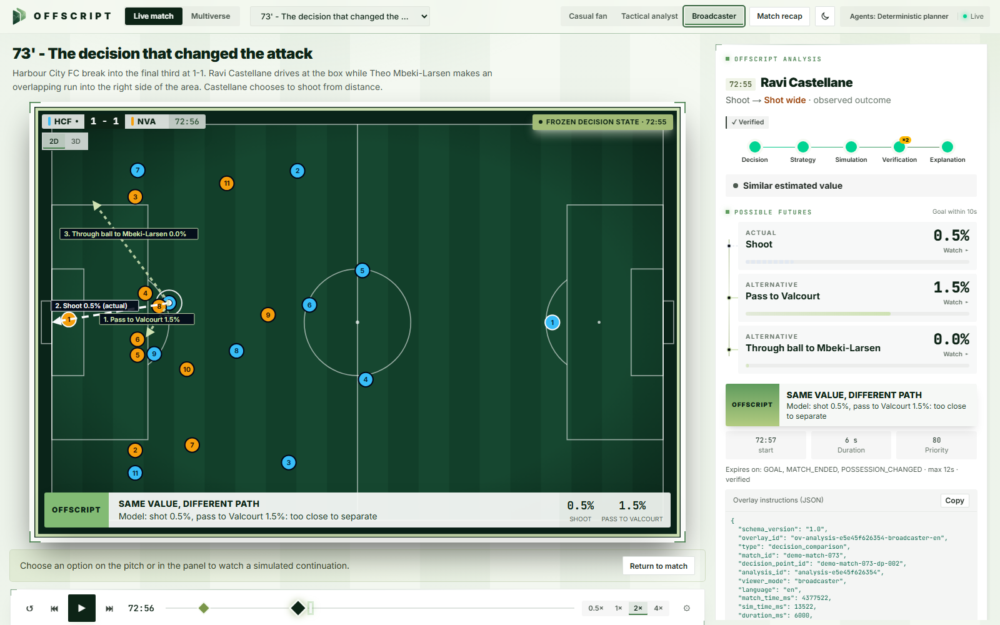 | 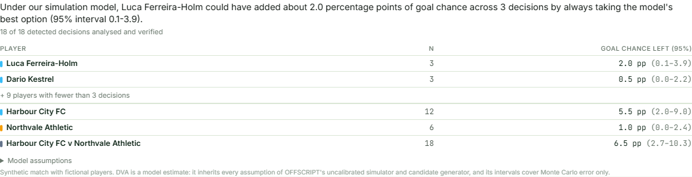 |

**Football Multiverse**: a user-chosen pass, the defending agent's best answer (cover the lane) and
the decision tree with the canonical synthetic timeline kept apart.

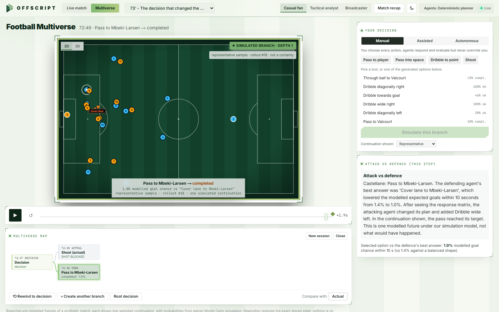

| Agent battle and response matrix | Split-screen branch comparison |
|---|---|
| 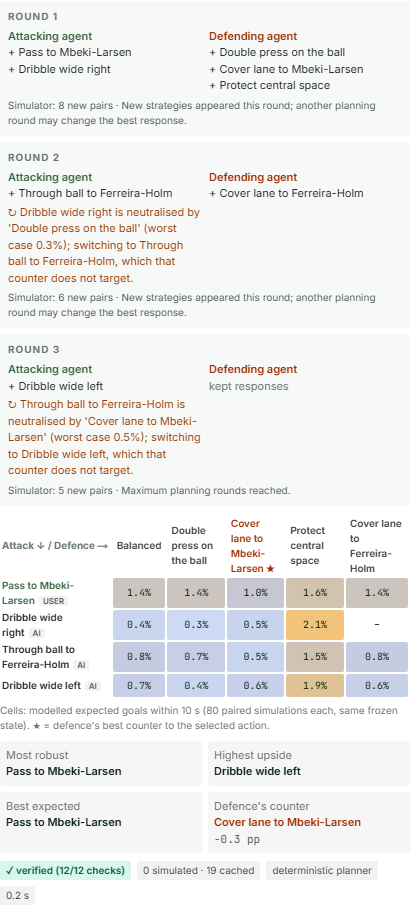 | 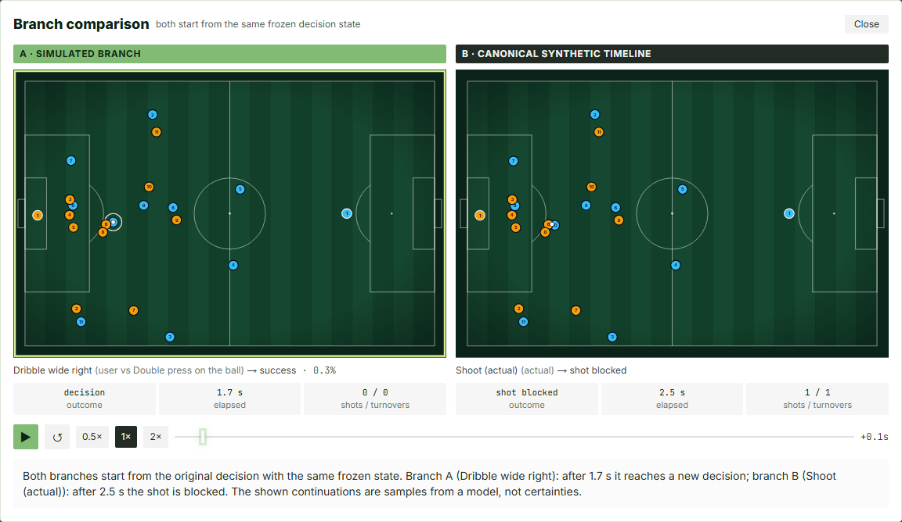 |

## Quick start

Requirements: Python 3.12+, Node.js 22+ (24 recommended). No cloud account needed.

```bash
# 1) API  (http://localhost:8000, OpenAPI docs at /docs)
cd apps/api
python -m venv .venv && . .venv/bin/activate        # Windows: .venv\Scripts\activate
pip install -r requirements-dev.txt
uvicorn app.main:app --port 8000
```

```bash
# 2) Web app (http://localhost:3000) - from the repository root, in a second terminal
npm ci
npm run dev:web
```

Open http://localhost:3000 for the landing page, or go straight to the app at
http://localhost:3000/app/. Keep **"73' - The decision that changed the attack"**, press ▶ (2× is a
good speed). For the Multiverse, open the **Multiverse** tab (or "Explore in the Multiverse" on an
analysis), choose the 72:47 decision, pick *Pass to player* and click a highlighted teammate. Or run
everything with Docker: `docker compose up --build`.

**Live Microsoft Foundry model** (optional): set `FOUNDRY_PROJECT_ENDPOINT` and `FOUNDRY_MODEL` in
`.env` (see [.env.example](.env.example)), run `az login`, restart the API, then
`curl -X POST localhost:8000/api/diagnostics/foundry`. Without these settings the agents run on a
clearly labelled deterministic policy planner (same tools, same workflow, no LLM).

## How it works

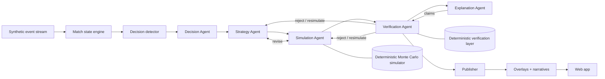

* **Agents decide, code computes.** Agents (Microsoft Agent Framework `Agent`s with allow-listed
  tools and structured outputs, orchestrated by a `WorkflowBuilder` graph with switch-case handoffs
  and bounded retries) choose which moment to analyse, which alternatives are meaningful, how much
  simulation budget to spend, whether the evidence holds, and how to explain it. Every number comes
  from deterministic Python tools and is traceable to an evidence field.
* **Fair counterfactuals.** Same frozen snapshot, same metric and horizon, same rollout budget and
  common random numbers for every option; defenders react to the *alternative* ball, not to the
  original timeline. → [docs/simulator.md](docs/simulator.md)
* **Verification with teeth.** Probabilities, Wilson intervals, counts, paired comparisons,
  feasibility, snapshot consistency and reproducibility are re-checked deterministically; narratives
  are checked number by number. The Verification Agent cannot override a failed check.
  → [docs/multi-agent-system.md](docs/multi-agent-system.md)
* **Live and broadcast-ready.** Microsecond state updates, async analyses that stream every agent
  start, tool call and handoff over WebSocket, timestamped overlay instructions with priority and
  expiry rules.
  → [docs/architecture.md](docs/architecture.md)

## Results (synthetic data, internal consistency - not real-world validity)

| | |
|---|---|
| Detected decisions verified end-to-end | **24/24** (4 scenarios + 10-minute procedural segment) |
| Injected numeric / narrative corruptions caught | **240/240** / **432/432**, 0/144 false positives |
| Stress-test faults recovered (impossible pass, false number, model outage, simulation cut short) | **12/12** |
| Reproducibility (re-analysis, trajectory replay, scenario regeneration) | bit-identical |
| End-to-end analysis, 3 options × 200 rollouts, policy agents | ~2.6 s p50 |
| Multiverse: single-decision value optimistic vs the defence's best counter | **0.61 pp** mean; robust choice differs in **1/3** decisions |
| Multiverse plannings verified / narratives grounded | **6/6** / **36/36**; repeated planning served 19/19 cells from cache |

Full method and numbers: [docs/evaluation.md](docs/evaluation.md) · generated tables:
[docs/evaluation_results.md](docs/evaluation_results.md). Multiverse (single-decision vs branching vs
adversarial): [docs/multiverse_evaluation.md](docs/multiverse_evaluation.md). Tests: 87 backend
(pytest), 43 frontend unit (Vitest), 8 end-to-end (Playwright, real browser + real backend).

## Microsoft technologies

| | |
|---|---|
| Microsoft Agent Framework | Agents, tools with budgets, middleware tracing, structured outputs, workflow graph, shared state |
| Microsoft Foundry | **Live** in the deployed demo: a `gpt-4.1-mini` deployment drives every agent, keyless via managed identity; diagnostics endpoint and optional live test |
| Azure Container Apps (scale to zero), Storage static website, Application Insights | **Deployed**; Bicep templates (`infra/azure`), one-command deploy (`scripts/deploy_azure.sh`) and automatic deploys from GitHub Actions after CI passes (OIDC, no stored secrets) - see [deployment](docs/deployment.md) |

## Repository

```
apps/api        FastAPI backend: simulation, synthetic data, match state, detection, agents,
                orchestration, verification, narratives, multiverse, services, API (+ tests)
apps/web        Next.js 16 static app: 2D/3D pitch, timeline, analysis, live agent log, stress test,
                DVA, multiverse (+ Vitest, Playwright)
packages/contracts  OpenAPI schema + generated TypeScript types (single source: Pydantic models)
scenarios/      Inspectable scenario definitions (positions, script, seed, labels)
infra/          Bicep (Azure) and Dockerfiles      scripts/  evaluation, OpenAPI export, cache warm-up
docs/           architecture, simulator, multi-agent system, evaluation, deployment, limitations,
                hackathon submission, demo script, deviations from the brief
```

## Documentation

[Architecture](docs/architecture.md) · [Football Multiverse](docs/multiverse.md) · [Simulator](docs/simulator.md) ·
[Multi-agent system](docs/multi-agent-system.md) · [Evaluation](docs/evaluation.md) ·
[Deployment](docs/deployment.md) · [Limitations](docs/limitations.md) ·
[Hackathon submission](docs/hackathon-submission.md) · [Demo script](docs/demo-script.md) ·
[Deviations from the brief](docs/brief-deviations.md)

## Licence and assets

MIT ([LICENSE](LICENSE)). All teams, players, matches and events are fictional and synthetic. The
logo and pitch graphics are original SVG; fonts are Inter and JetBrains Mono (SIL Open Font
License) via `next/font`. No Premier League footage, data, marks or branding are used.
