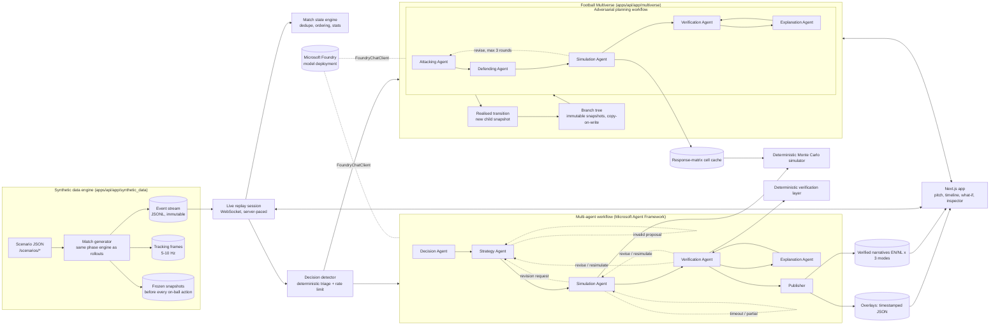

# Architecture

PARALLEL is a monorepo with a Python backend (FastAPI + Microsoft Agent Framework), a static
Next.js frontend, shared contracts generated from the backend's Pydantic models, and Azure
infrastructure as code.

## Components

| Area | Path | Responsibility |
|---|---|---|
| Contracts | `apps/api/app/models` → `packages/contracts` | Versioned Pydantic models (`schema_version` 1.0); OpenAPI → TypeScript (`npm run contracts`). CI fails if either side is stale. |
| Geometry | `apps/api/app/simulation/geometry.py` | 105 × 68 m pitch, world ↔ attack-frame conversion (180° rotation), goal angles, zone value. |
| Rollout engine | `apps/api/app/simulation/engine.py` | Phase-based physics + probabilistic pass/shot/dribble models, off-ball behaviour, in-rollout policy. |
| Monte Carlo | `apps/api/app/simulation/monte_carlo.py` | Common random numbers, Wilson intervals, paired comparisons, medoid representative rollouts, deterministic replay. |
| Candidates | `apps/api/app/simulation/candidates.py` | Deterministic enumeration + validation of shots, passes, through balls, dribbles. |
| Synthetic data | `apps/api/app/synthetic_data` | Fictional roster, formations, scripted scenarios, procedural match generation. |
| Match state | `apps/api/app/match_state/engine.py` | Idempotent, order-preserving event ingestion; observed vs modeled statistics; deterministic replay. |
| Detection | `apps/api/app/analytics/detector.py` | Streaming decision-point detector (features from the pre-decision snapshot only). |
| Agents | `apps/api/app/agents` | Agent prompts, structured outputs, policy chat client, runner with Foundry → policy fallback and tool-call tracing. |
| Orchestration | `apps/api/app/orchestration/workflow.py` | Agent Framework `WorkflowBuilder` graph, executors, tools, bounded retries, fault injection. |
| Verification | `apps/api/app/verification` | Deterministic checks on analyses, evidence table, narrative grounding. |
| Narratives | `apps/api/app/narratives/templates.py` | EN/NL deterministic narratives per viewer mode (policy mode and fallback). |
| Defence model | `apps/api/app/simulation/defense.py` | Validated defensive strategies (press, cover lane, track runner, protect central, contain) that change defender targets, reactions and tackles in the engine. |
| Multiverse | `apps/api/app/multiverse` | Branch tree service + persistence, cell evaluator/cache, transitions and successor snapshots, adversarial planning workflow, verification, narratives. See [multiverse.md](multiverse.md). |
| Services | `apps/api/app/services` | Store, analysis jobs + cache, live replay sessions, overlays, recap, metrics, WebSocket hub. |
| API | `apps/api/app/api` | REST (`/api/...`, `/api/multiverse/...`, OpenAPI at `/docs`) and WebSockets (`/ws/matches/{id}`, `/ws/multiverse/{session}`). |
| Web | `apps/web` | Next.js 16 static export, Tailwind 4, zustand; SVG pitch; Vitest + Playwright. |
| Infra | `infra/azure`, `infra/docker`, `azure.yaml`, `.github/workflows` | Bicep (Container Apps, SWA, ACR, App Insights, managed identity), Dockerfiles, CI/CD. |

## Data flow for one decision

1. The **match generator** (or a real feed in future) emits immutable events; every on-ball action
   carries the id of a **snapshot** captured immediately before it.
2. The **live session** streams frames/events to the browser at the replay clock and ingests every
   event into the **match state engine** (duplicates ignored, gaps re-ordered).
3. The **decision detector** computes cheap features from that snapshot only (no future
   information), waits for the action's outcome, scores triggers and applies rate limiting.
4. Detected decisions start an **analysis job**: the multi-agent workflow runs in the background;
   progress events (agent started/completed, tool calls, handoffs) are pushed over the WebSocket.
5. The **publisher** emits verified narratives and timestamped **overlay instructions**; the browser
   schedules them against the playback clock with priority and expiry rules.
6. Selecting an option re-runs one rollout from its seed (`/trajectories`) and animates it as a
   clearly labelled **simulated** continuation.

## Data flow for one Multiverse step

1. `POST /api/multiverse/sessions` freezes the decision's snapshot as the root node and adds the
   observed continuation as a read-only `observed` node.
2. `POST .../branches/{node}/actions` validates the user's action, then starts a job (202). The
   adversarial workflow evaluates the response matrix (cells cached by snapshot digest, action,
   strategy, budget, seed, horizon and simulator version), verifies it and writes narratives.
3. One rollout of the selected action vs the defence's counter is replayed; the engine state after
   the first action becomes a new immutable child snapshot and node. The parent is never mutated.
4. The session is persisted to JSON; progress and completion are pushed over `/ws/multiverse/{id}`.
5. `GET .../trajectory` returns the concatenated frames from the root for playback; `POST
   /api/multiverse/compare` aligns two branches from their common ancestor.

## Correlation and observability

Every analysis has a `correlation_id` that appears in the workflow state, structured JSON logs, the
WebSocket progress messages and (when `APPLICATIONINSIGHTS_CONNECTION_STRING` is set) OpenTelemetry
traces via `azure-monitor-opentelemetry` plus Agent Framework instrumentation. In-process latency
metrics (p50/p95) are exposed at `GET /api/metrics`, including `multiverse.planning` and
`multiverse.branch_creation`. Each multiverse planning has its own `correlation_id`, agent steps and
tool-call trace.

## Real-time design

* Fast path (per event): state update ~2 µs p50, detection features cached per event.
* Expensive path (per decision): Monte Carlo in a worker thread (`asyncio.to_thread`), bounded by a
  semaphore (`MAX_CONCURRENT_ANALYSES`), a time budget and cancellation; the UI never blocks.
* No LLM call happens for movement or position updates: models are only used per analysed decision.

## Why a static frontend + container API

The web app has no secrets and no server code, so it is exported as static files (Azure Static Web
Apps). All model access stays in the API container, which authenticates to Microsoft Foundry with
a managed identity; judges never need credentials.
