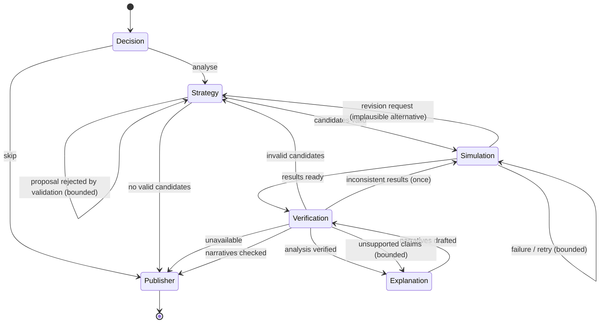

# Multi-agent system

OFFSCRIPT's analysis is a **Microsoft Agent Framework workflow** (`agent-framework-core` 1.22,
`agent-framework-foundry` 1.15) of five specialised agents plus a publisher. Each agent is an
Agent Framework `Agent` with its own instructions, its own allow-listed tools and a Pydantic
structured-output schema. The agents never compute football numbers themselves; they decide,
coordinate and explain, while deterministic tools do the mathematics.

Source: `apps/api/app/orchestration/workflow.py`, `apps/api/app/agents/`.

The **Football Multiverse** adds a second workflow with two adversarial agents (Attacking and
Defending) that plan against each other; it is described [below](#football-multiverse-adversarial-planning)
and in [multiverse.md](multiverse.md).

## Agents, tools and outputs

| Agent | Responsibility | Tools (deterministic, validated arguments, `max_invocations` budget) | Structured output |
|---|---|---|---|
| Decision Intelligence | Is this moment worth a full analysis for viewers? Priority. | `get_decision_context`, `get_analysis_budget` | `DecisionAssessment` |
| Strategy | Choose strategically meaningful, *feasible* alternatives; revise after feedback | `generate_candidate_actions`, `validate_candidate_action` | `StrategyProposal` (candidate ids or custom proposals) |
| Simulation | Choose budgets, run the simulator, judge stability, request revisions | `run_simulation(rollouts)`, `request_strategy_revision` | `SimulationReport` |
| Verification | Check the analysis, later the narratives; route failures | `run_verification_checks`, `verify_narratives` | `VerificationDecision` (status + route) |
| Explanation | Personalised narratives (3 viewer modes × EN/NL) from verified evidence only | `get_verified_evidence`, `check_narrative` (self-check) | `ExplanationBundle` |
| Publisher (executor) | Finalise status, replace failing narratives with verified templates, build overlays | – | `CounterfactualAnalysis` |

## Workflow graph

Built with `WorkflowBuilder` and switch-case edge groups:

Every loop is bounded by counters in the shared state (`MAX_STRATEGY_REVISIONS`, explanation
retries, one re-simulation) and by `max_iterations=40` on the workflow itself. A test proves that a
strategy that keeps proposing invalid actions ends in a safe `unavailable` state after exactly
`max_strategy_revisions + 1` attempts.

## Shared state

`AnalysisWorkflowState` (typed, versioned) is the single source of truth: snapshot and decision ids,
actual/candidate action ids, rejected proposals with reasons and stage, revision feedback,
simulation run id and budget, verification status and issues, retry counters, narrative ids,
every agent step (task, attempt, model, tool calls, structured output, handoff, notes, timing),
handoff records, errors, degraded flag and state version. Agent Framework workflow state keeps a
versioned snapshot of it plus the route history (published on every handoff). Heavy objects
(snapshot, candidates, simulation results) are referenced by id.

## Why multiple agents (and not one prompt)

* **Distinct competence and tools**: only the Strategy Agent can enumerate actions; only the
  Simulation Agent can spend simulation budget; only the Verification Agent can approve evidence.
  Narrow tool sets make each agent auditable and keep prompts small.
* **Feedback loops a single pass cannot do**: the simulator's result can send the Strategy Agent
  back to the drawing board; the verifier can reject a narrative and force a rewrite.
* **Separation of judgement from computation**: agents choose *which* question to ask and *how*
  to explain it; deterministic code produces every number.
* **Failure isolation**: a model failure in one agent degrades that step only (policy fallback) and
  is visible in the trace.

## Guardrails

* Tools are allow-listed per agent, arguments are type-validated by Agent Framework, and every
  candidate is re-validated by `validate_candidate` (players on pitch, teammates, distances,
  same snapshot). Agents cannot introduce coordinates or players the generator did not produce
  without passing validation.
* Deterministic verification cannot be overridden: if any error-level check fails, the executor
  forces `rejected` even if the agent says `verified` (tested).
* Narratives are checked number-by-number against the evidence table (both `.` and `,` decimals),
  for certainty language ("would have scored"), for players not involved in the decision, and for a
  model qualifier. Failing narratives are regenerated, then replaced by verified templates.
* Tool-call budgets (`max_invocations`), function-invocation limits (`max_function_calls`), model
  timeouts, simulation time budgets, a concurrency semaphore and API rate limits bound cost.

## Microsoft Foundry and the deterministic policy client

`ChatClientProvider` creates an Agent Framework `FoundryChatClient` from `FOUNDRY_PROJECT_ENDPOINT`
and `FOUNDRY_MODEL`, authenticated with `DefaultAzureCredential` (managed identity in Azure,
`az login` locally). Each agent call tries, in order:

1. a simulated-outage client (only for the controlled *model unavailable* fault injection);
2. the live Foundry deployment (when configured);
3. `PolicyChatClient` - a transparent, rule-based planner implemented as an Agent Framework chat
   client. It issues real tool calls through the same function-invocation loop and middleware and
   returns the same structured JSON. Its output is always labelled `policy` and never presented as
   live model output.

Every agent step records which of these produced it (`model`, `live_model`, notes on failures). The
UI header shows the active mode, and each narrative states whether it was written by a Foundry
deployment or generated by the policy templates. `POST /api/diagnostics/foundry` performs one live
structured-output call to verify a deployment.

## Controlled failure scenarios (all automated tests, all available in the UI as the "Stress test: break it on purpose")

| Fault | What happens | Recovery |
|---|---|---|
| `invalid_candidate` | An extra proposal "pass to a substitute" is injected into the Strategy Agent's first output | Validation rejects it (`PLAYER_NOT_ON_PITCH`), feedback is added to shared state, the Strategy Agent revises |
| `contradictory_claim` | A probability inconsistent with the simulation is inserted into the first narrative | Verification Agent rejects the claim and hands back to the Explanation Agent, which regenerates |
| `model_unavailable` | Every agent's model call fails with a provider outage | Each step falls back to the policy planner, analysis is marked `degraded`; deterministic statistics are still shown |
| `simulation_timeout` | The first simulation run gets a 0.25 s budget | A partial, still-fair result (equal rollouts per option) is detected; the Simulation Agent re-runs with a preview budget |

Fault-injected analyses are separate jobs: they never overwrite the main analysis, cache or overlays.

## Football Multiverse: adversarial planning

A second Agent Framework workflow (`apps/api/app/multiverse/workflow.py`) runs each branching step.
It reuses the same runner (Foundry → labelled policy fallback), tool tracing middleware and
deterministic verification, with two new agents that have **opposing objectives**:

| Agent | Objective | Tools | Output |
|---|---|---|---|
| Attacking | Maximise modelled xG within the horizon; must keep the user's action | `get_match_state`, `get_available_actions` (with already-tried list), `get_planning_feedback` | `AttackPlan` |
| Defending | Minimise it with feasible defensive strategies | `get_threat_assessment`, `get_defensive_options`, `validate_defensive_strategy`, `get_planning_feedback` | `DefensePlan` |
| Simulation | Evaluate every (action, defence) pair with equal paired budgets; decide whether another round can change the answer | `evaluate_response_matrix` | `MatrixReport` |
| Verification | 12 deterministic checks on the matrix, summary, user-action respect and transition replay; then narrative grounding | `run_multiverse_checks`, `verify_narratives` | `VerificationDecision` |
| Explanation | Casual / analyst / broadcaster × EN/NL from the planning evidence table | `get_planning_evidence`, `check_narrative` | `ExplanationBundle` |

Attack → Defence → Simulation repeats for at most 3 rounds (tabu list and a 0.2 pp improvement
threshold stop oscillation); `max_iterations=40` bounds the graph. The agents choose *which* cells to
evaluate and *which* action to realise; every number comes from the simulator. In manual mode the
selected action is always the user's (`user_action_respected` check); in assisted mode the
recommendation is stored on the node and never creates a branch until accepted; in autonomous mode
the attacking agent's most robust option is played step by step. Recommendations are labelled
"AI RECOMMENDED", agent-chosen branches "AI", user branches "USER", and the observed timeline
"ACTUAL".
