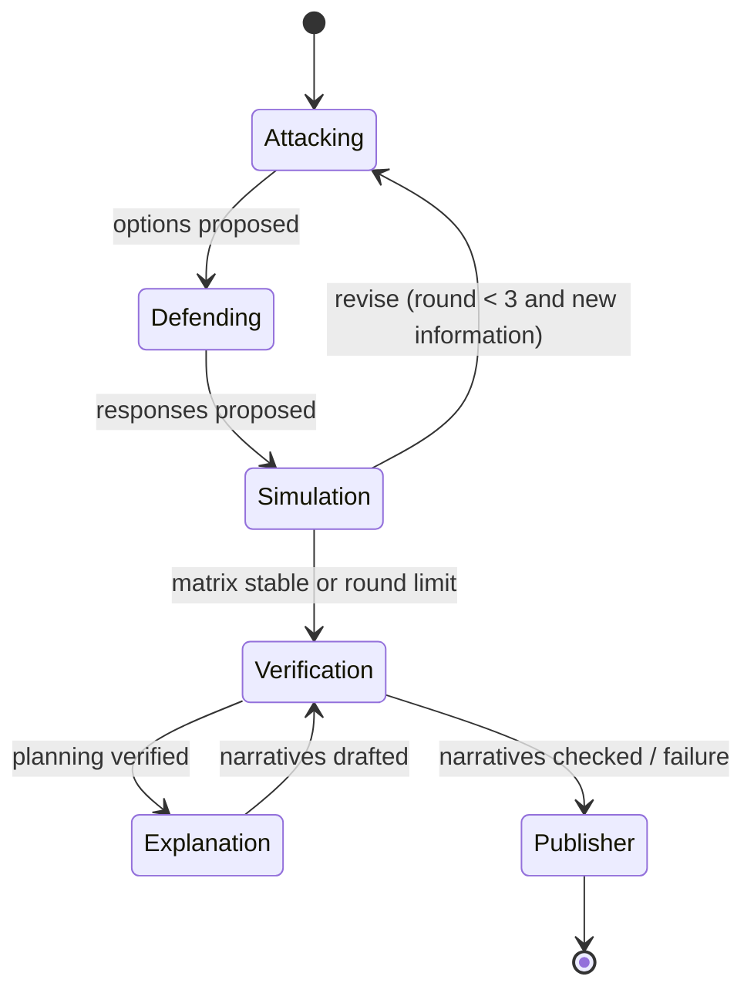

# Football Multiverse

The Football Multiverse turns a detected decision into a **branching, adversarial decision
simulator**. From a frozen match state the user (or an agent) chooses an action; an attacking agent
and a defending agent plan against each other over a bounded response matrix; the simulator
evaluates every pairing with paired Monte Carlo rollouts; one continuation is realised as a new,
immutable match state from which the next decision can be taken. Users can rewind to any node,
fork a sibling branch and compare two branches side by side.

Everything shown is a **model estimate on synthetic data**. The observed timeline is labelled
"canonical synthetic timeline"; every other branch is labelled "simulated branch". Simulated
branches never change the synthetic match feed.

Source: `apps/api/app/multiverse/`, `apps/api/app/simulation/defense.py`,
`apps/api/app/api/multiverse_routes.py`, `apps/web/components/multiverse/`, `apps/web/lib/mvStore.ts`.

## Capabilities

| Brief capability | Implementation |
|---|---|
| A. User-chosen actions | Pass to a clicked teammate, pass into a clicked space (receiver = the teammate most likely to arrive first, otherwise `TARGET_UNREACHABLE`), dribble to a clicked point, shoot, or any generated option. Every action is validated (`POST .../validate`) and rejected with a code, never silently rewritten. |
| B. Adversarial agents | Attacking Agent proposes options (always keeps the user's action); Defending Agent proposes validated defensive strategies (press, cover lane, track runner, protect central space, contain) that change the defenders' targets and reactions in the engine. Up to 3 rounds of revision. |
| C. Monte Carlo outcomes | Each (action, defence) cell: equal, paired rollouts (common random numbers), modelled xG within the horizon with a 95% interval, P(goal), P(shot), P(turnover), P(first action succeeds). |
| D. Grounded explanations | Casual / analyst / broadcaster × EN/NL narratives, every number from the planning's evidence table and checked by the same verifier as the live analysis. |
| E. Branching | Tree of nodes with copy-on-write snapshots, rewind, fork, depth/children/node limits, idempotent requests, persistence, synchronised split-screen comparison. |

## Data model

* **Snapshot** - an immutable `MatchStateSnapshot`. The root uses the detected decision's snapshot;
  each simulated child gets a new snapshot built from the engine state after the first action plus
  the control moment before the next decision. Parents are never mutated (checked by
  `parent_immutable` and a SHA-256 digest test).
* **BranchNode** - `root` (the frozen decision), `observed` (the canonical synthetic continuation,
  read-only) or `simulated`. Status: `decision`, `terminal` (goal, save, turnover, ...),
  `depth_limit` or `failed`. Each simulated node stores the entering action, its source (`user` or
  `attacking_agent`), the defensive strategy that was realised, the replayable `Transition`
  (rollout index, seed, selection rule, frames, events) and the planning id.
* **MultiversePlanning** - rounds, attack and defence proposals, the response matrix, the strategy
  summary, verification checks, narratives, agent steps, handoffs, cost (cells computed, cache hits)
  and timing.
* **Session** - the tree, snapshots and plannings, persisted as JSON in `data/multiverse/` and
  restored on demand (a new API process serves existing sessions unchanged).

## Adversarial planning workflow

An Agent Framework workflow (`parallel-multiverse-adversarial-planning`, `max_iterations=40`):

| Agent | Tools | Output |
|---|---|---|
| Attacking | `get_match_state`, `get_available_actions` (returns already-tried options: tabu list), `get_planning_feedback` | `AttackPlan` |
| Defending | `get_threat_assessment`, `get_defensive_options`, `validate_defensive_strategy`, `get_planning_feedback` | `DefensePlan` |
| Simulation | `evaluate_response_matrix` (equal budget for every cell, cache-aware) | `MatrixReport` (continue or stop) |
| Verification | `run_multiverse_checks`, `verify_narratives` | `VerificationDecision` |
| Explanation | `get_planning_evidence`, `check_narrative` | `ExplanationBundle` |

Round 1: the attacker proposes the user's action (or, without one, the actual action), the best
viable pass and a different type of action; the defender answers the most dangerous threats. Later
rounds: the attacker replaces its weakest non-user option only if that option's worst case is below
the best worst case by more than 0.2 pp, using untried candidates that avoid the counter's covered
targets; the defender adds counters to new threats. Planning stops when nothing new is proposed or
after 3 rounds.

**Summary** (computed deterministically from the matrix): *most robust* = maximin over defences,
*best expected* = mean, *highest upside* = best case; the *defensive counter* is the defence that
minimises the selected action's value. In manual and assisted-accept modes the selected action is
always the user's.

**Realisation.** One rollout of the selected action against the counter is chosen
(`representative` = medoid of the modal first outcome, `high_upside`, `defensive_success`, or a
seeded `random` sample), its first action is replayed with the same random streams, and the resulting
engine state becomes the child snapshot.

**Verification** (12 checks, error-level checks cannot be overridden by an agent): same snapshot,
actions valid, strategies valid, matrix complete, equal budget per cell, matrix values consistent
with the rollouts, summary consistent with the matrix, user action respected, rounds bounded, parent
immutable, transition reproducible (re-replayed), successor state valid (players on pitch,
possession consistent with the outcome).

## Defensive strategies in the simulator

`DefenseRuntime` (in `simulation/defense.py`) changes the engine in three places: defender target
positions (press the carrier, cover a passing lane, track a runner, protect central space, contain),
defender reaction multipliers on passes and dribbles (clipped to 0.55-1.4), and the tackle
probability in dribble duels (contain 0.75×, press 1.15×). Strategies are validated:
max 3 assignments, defenders on the pitch, no goalkeeper, no duplicates, targets must be attackers,
lanes must be valid, and each defender must be able to reach its role within 2.5 s. The balanced
baseline reproduces the original engine exactly (tested).

## Value metric

Cells use **modelled expected goals within the horizon** (default 10 s): each rollout that ends in a
shot contributes its conditional goal probability, estimated with 24 independent draws of the shot
model from the shot state (conditional Monte Carlo, an unbiased estimator of P(goal) with much lower
variance). Binary P(goal) and P(shot)/P(turnover) are reported alongside. Default 80 rollouts per
cell (configurable up to 200); all cells of one planning use the same budget and seed (paired).

## Interaction modes

* **Manual** - the user chooses every action; agents only respond and evaluate.
* **Assisted** - the attacking agent recommends the most robust option (no branch is created until
  the user accepts or picks something else).
* **Autonomous** - agents play attack and defence until a terminal outcome, the depth limit or the
  requested number of steps.

## Limits and cost control

`multiverse_max_depth` 3, `multiverse_max_children` 6 per node, `multiverse_max_nodes` 40 per
session, `multiverse_max_sessions` 200, 3 planning rounds, 80 (max 200) rollouts per cell, a
planning timeout of 180 s, a shared concurrency semaphore, API rate limits, an LRU cache of matrix
cells keyed by snapshot digest, action, strategy, budget, seed, horizon and simulator version, and
idempotent step requests (the same request on the same node returns the existing branch).
Jobs can be cancelled; a cancelled or failed job never leaves a half-built node.

## API

| Method | Path | Purpose |
|---|---|---|
| POST | `/api/multiverse/sessions` | Create a session at a decision (root + observed nodes) |
| GET | `/api/multiverse/sessions/{id}`, `/tree` | Session summary, tree |
| GET | `/api/multiverse/branches/{node}`, `/state`, `/options` | Node, frozen snapshot, options |
| POST | `/api/multiverse/branches/{node}/validate` | Validate an action spec |
| POST | `/api/multiverse/branches/{node}/actions` | Plan and branch with an action (202, job) |
| POST | `/api/multiverse/branches` | Same, with `parent_node_id` in the body |
| POST | `/api/multiverse/branches/{node}/continue` | Assisted recommendation / autonomous single step |
| POST | `/api/multiverse/branches/{node}/auto-play` | Autonomous multi-step play |
| GET | `/api/multiverse/jobs/{id}` | Job status and progress |
| POST | `/api/multiverse/branches/{node}/cancel` | Cancel running jobs on a node |
| GET | `/api/multiverse/branches/{node}/trajectory` | Concatenated frames from the root, with step boundaries |
| GET | `/api/multiverse/branches/{node}/analysis`, `/agents` | Narratives, agent steps |
| GET | `/api/multiverse/plannings/{id}` | Full planning (matrix, rounds, checks) |
| POST | `/api/multiverse/compare` | Compare two nodes (metrics, steps, EN/NL explanation) |
| WS | `/ws/multiverse/{session_id}` | Live agent progress and job completion |

Errors return `{"detail": {"code", "message"}}` (e.g. `OPPONENT_TARGET`, `TARGET_UNREACHABLE`,
`OBSERVED_NODE`, `DEPTH_LIMIT`, `TOO_MANY_BRANCHES`, `ACTION_REQUIRED`).

## User interface

The **Multiverse** tab (or "Explore in the Multiverse" from an analysis) shows the pitch with
selectable teammates, the action composer (tools, options, ACTUAL / AI RECOMMENDED tags, validation,
mode switch, continuation selector), the decision tree (pending ghost node while agents plan), the
simulated/observed banner, defensive arrows of the realised counter, synchronised playback of the
whole path, the narrative for the current viewer mode, the agent battle (rounds, response-matrix
heatmap, robust/upside/expected summary, verification badge) in analyst mode, a live agent activity
feed, a workflow inspector and a split-screen comparison with shared play/scrub/speed controls.

## Evaluation

`scripts/evaluate_multiverse.py` compares single-decision (A), branching (B) and adversarial (C)
evaluation on every labelled decision; see [multiverse_evaluation.md](multiverse_evaluation.md).
